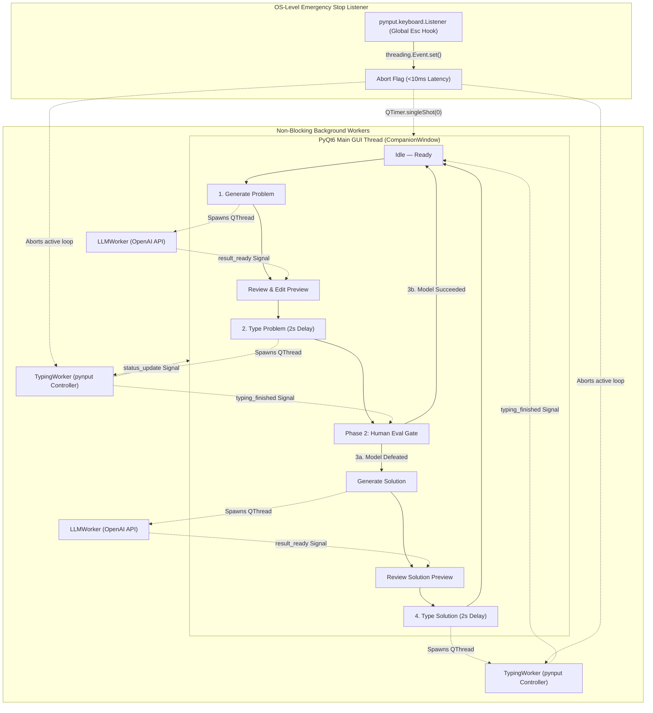

# Adversarial LLM Evaluation Companion

A production-grade, Always-on-Top desktop evaluation companion built with **Python 3.10+ (tested on Python 3.14)**, **PyQt6**, **`pynput`**, and the official **`openai` SDK**. 

The companion automates adversarial prompt generation and testing against external AI web models (ChatGPT, Claude, Gemini, proprietary evaluation sandboxes) where **clipboard paste (`Ctrl+V`) is disabled**, while enforcing strict **Human-in-the-Loop (HITL)** inspection and an instantaneous **OS-level Emergency Stop**.

---

## Architecture Overview



---

## Key Features

1. **Always-On-Top Floating Interface:** Configured with `Qt.WindowType.WindowStaysOnTopHint` to float conveniently alongside browser evaluation windows without losing focus.
2. **Non-Blocking Concurrency:** All OpenAI network requests and keystroke emulation sequences run in dedicated `QThread` workers, guaranteeing the PyQt6 UI event loop never freezes.
3. **Hardware Keystroke Emulation (Anti-Paste Bypass):** Types text character-by-character using OS-level scan codes via `pynput.keyboard.Controller`, bypassing web inputs that block `Ctrl+V`.
4. **Chat-Safe Newlines (`Shift+Enter`):** Automatically maps `\n` to `Shift+Enter` to prevent web chat forms from prematurely submitting multiline puzzles.
5. **Human-in-the-Loop Preview & Edit:** Text is never typed automatically. Prompts and solutions populate an editable `QPlainTextEdit` widget where the operator can inspect, reformat, or modify content before initiating typing.
6. **Sub-10ms Emergency Stop:** A background low-level keyboard listener intercepts `Esc` across the entire operating system, immediately aborting the countdown or typing loop and safely re-enabling the controls for immediate retry.

---

## Project Structure

```text
Adversarial LLM Evaluation Companion/
├── .env.example                  # Environment configuration template
├── .gitignore                    # Git exclusions (.venv, .env, build, dist, cache)
├── requirements.txt              # Production Python package requirements
├── README.md                     # Architecture, setup, run, and build documentation
├── main.py                       # Application bootstrap and QApplication entrypoint
├── build_standalone.py           # PyInstaller automated production packaging script
├── app/
│   ├── __init__.py
│   ├── config.py                 # Centralized configuration & constants
│   ├── core/
│   │   ├── __init__.py
│   │   └── states.py             # Granular AppState enum definitions
│   ├── workers/
│   │   ├── __init__.py
│   │   ├── llm_worker.py         # LLMWorker(QThread) interfacing with OpenAI
│   │   └── typing_worker.py      # TypingWorker(QThread) interruptible keystroke engine
│   ├── listeners/
│   │   ├── __init__.py
│   │   └── hotkey_listener.py    # GlobalHotkeyListener capturing OS-level Esc
│   └── ui/
│       ├── __init__.py
│       ├── styles.py             # High-contrast modern dark QSS stylesheet
│       └── main_window.py        # CompanionWindow(QWidget) Always-on-Top HITL interface
└── dist/
    └── AdversarialCompanion/     # Production standalone binary distribution
        └── AdversarialCompanion.exe
```

---

## Quickstart & Local Setup

### 1. Prerequisites
- **Python 3.10+** (Tested and fully functional on **Python 3.14.10**).
- Valid **OpenAI API Key**.

### 2. Create Virtual Environment
```powershell
python -m venv .venv
.\.venv\Scripts\Activate.ps1
```

### 3. Install Dependencies
```powershell
pip install -r requirements.txt
```

### 4. Configure Environment Variables
Copy `.env.example` to `.env` and insert your OpenAI API key:
```powershell
copy .env.example .env
```

Edit `.env`:
```ini
OPENAI_API_KEY=sk-proj-your-actual-api-key-here
MODEL_NAME=gpt-4o
FOCUS_DELAY_SECONDS=2
MIN_TYPE_DELAY=0.003
MAX_TYPE_DELAY=0.010
EMERGENCY_STOP_KEY=<esc>
```

### 5. Run the Application
```powershell
.\.venv\Scripts\python.exe main.py
```

---

## Operational Walkthrough (HITL State Machine)

1. **Step 1: Generate Adversarial Problem**
   - Click **`1. Generate Problem`**.
   - The status updates to `Generating problem...` while `LLMWorker` calls OpenAI with custom red-teaming system prompts (deceptive logic puzzle, reasoning trap, or counter-intuitive edge case).
2. **Step 2: Inspect & Edit Preview**
   - The generated prompt populates the **Preview & Edit Area**.
   - Review or manually adjust the puzzle directly in the text box.
3. **Step 3: Type Problem into Browser**
   - Click **`2. Type Problem (2s Focus Delay)`**.
   - The status banner ticks: `Waiting for focus — 2 seconds` -> `Waiting for focus — 1 second`.
   - **Immediately click into your browser's input box** during this 2-second countdown.
   - Keystrokes are typed character-by-character with human-like jitter (`3ms` to `10ms`).
   - Newlines (`\n`) are cleanly typed as `Shift+Enter` so the chat message does not submit prematurely.
4. **Step 4: Human Evaluation Gate**
   - Upon completion, status displays `Typing completed`, pauses for 1 second, and transitions to `Waiting for human evaluation`.
   - The operator inspects how the target model replied:
     - **If the model succeeded:** Click **`3b. Model Succeeded -> Reset`**. The preview clears and resets to `Idle — Ready`.
     - **If the model was defeated (fell into the trap):** Click **`3a. Target Defeated -> Gen Solution`**.
5. **Step 5: Generate & Type Ground-Truth Solution**
   - `LLMWorker` produces a rigorous, step-by-step verified ground-truth solution based on the puzzle context.
   - The operator reviews/edits the solution in the preview box.
   - Click **`4. Type Solution (2s Focus Delay)`**, switch focus to the browser, and the companion types the solution.
6. **Emergency Stop (Esc):**
   - Press `Esc` (or click `STOP TYPING (ESC)`) at any time.
   - Typing immediately aborts in `<10ms`.
   - The preview text is preserved, and the `Type` button is re-enabled so you can refocus the window and retry without re-generating.

---

## Production Build Instructions

To build a standalone Windows binary distribution that runs without requiring Python to be installed:

```powershell
.\.venv\Scripts\python.exe build_standalone.py
```

The output will be placed in:
```text
dist/AdversarialCompanion/AdversarialCompanion.exe
```

The build script compiles with `--windowed` (no command prompt window), `--clean`, and packages all required `PyQt6` and `pynput` hooks.

---

## Technical Architecture & Code Choices Explained

### 1. Why `QThread` instead of Python `threading.Thread` or `asyncio`?
- **GUI Thread Affinity:** PyQt widgets are not thread-safe. Modifying a PyQt widget directly from standard Python threads (`threading.Thread`) causes undefined memory access, race conditions, or hard crashes.
- **Signal-Slot Queue:** `QThread` integrates natively with Qt's meta-object signal-slot engine. When `LLMWorker` or `TypingWorker` emits `result_ready` or `status_update`, Qt marshals the data safely across thread boundaries (`Qt.ConnectionType.QueuedConnection`) into the GUI event loop.

### 2. Sub-10ms Emergency Stop Latency
- Rather than waiting for a long chunk of text to finish, `TypingWorker` evaluates `if self.abort_event.is_set():` before **every single keystroke**.
- Because keystroke sleep jitter is between `0.003s` (3ms) and `0.010s` (10ms), the maximum response latency from pressing `Esc` to the loop breaking is strictly under `10ms`.
- During the 2-second focus countdown, `FOCUS_DELAY_SECONDS` is sliced into `0.1s` (100ms) increments, allowing instantaneous abortion before typing starts.

### 3. Thread-Safe Global Hook via `QTimer.singleShot(0, ...)`
- The global keyboard hook (`pynput.keyboard.Listener`) runs inside a raw OS daemon thread.
- When `Esc` is intercepted, it sets `abort_event.set()` (thread-safe primitive) and uses `QTimer.singleShot(0, self._handle_emergency_stop_triggered)` to request the UI thread to update the status banner safely without cross-thread widget access.

### 4. Chat-Safe Newline Translation (`Shift+Enter`)
- In modern web-based AI interfaces (ChatGPT, Claude, Gemini, Slack), pressing standard `Enter` (`\n`) executes form submission.
- `TypingWorker` intercepts `\n` and executes:
  ```python
  with self.controller.pressed(Key.shift):
      self.controller.press(Key.enter)
      self.controller.release(Key.enter)
  ```
  This creates a clean multiline break while keeping the cursor in the input field.

### 5. Preserving Human-in-the-Loop Edits
- When starting problem or solution typing, the application calls `self.preview_box.toPlainText()`.
- This ensures that if the human operator noticed an awkward phrasing, edited a variable, or removed meta-commentary in the preview area, the exact edited text is typed rather than the raw model generation.
